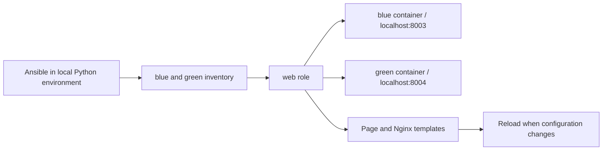

# How the lab works

[Português](guide.md) · [Back to the project](../README.en.md)

Run commands from the repository root.

## What each part does



Compose creates targets with Python that wait for tasks. The role installs/configures Nginx inside them. The `community.docker.docker` connection plugin accesses the Docker daemon through its CLI and executes modules in the targets. The socket is not mounted into targets.

Daemon access carries broad authority; use this project only with a Docker environment you control. No SSH ports, passwords or keys are required for this exercise.

## Inventory, variables and role

- `inventory/hosts.yml`: `web` group, target container names, connection and remote Python.
- `inventory/group_vars/web.yml`: shared page title and environment.
- `roles/web/defaults/main.yml`: defaults that inventory variables can override.
- `roles/web/tasks/main.yml`: input assertions, package installation, directory creation, templates and Nginx startup.
- `roles/web/handlers/main.yml`: Nginx reload after configuration changes.
- `playbooks/site.yml`: applies the role to the `web` group.

Allowed environments: `learning` and `staging`; colors: `blue` and `green`. Assertions reject other values before configuration tasks. The page directory is restricted to `/srv/ansible-lab`.

```bash
bash scripts/ansible.sh inventory --graph
bash scripts/ansible.sh web -m ansible.builtin.ping
bash scripts/ansible.sh playbook playbooks/site.yml --syntax-check
```

The wrapper explicitly sets `ANSIBLE_CONFIG`, needed for WSL/Windows directories reported as world-writable. Dependencies and caches stay under `.local/`, without a global Ansible install. Preparation uses `requirements.lock` when present and installs `community.docker` 5.4.0 without extra dependencies: this connection plugin does not require the additional inventory plugins.

## Templates and handler

The page identifies its host/environment. Configuration adds `X-Lab-Host` and `X-Lab-Environment` headers. Before replacing `nginx.conf`, template runs `nginx -t -c` against its temporary file; an invalid configuration should not replace the active file.

Only Nginx configuration notifies the handler. HTML changes need no reload. Repeated notifications of the same handler are grouped during a run. Tests observe the response header after reload.

These containers have no service manager. Initial startup uses a command guarded by `creates: /run/nginx.pid` to avoid restarting on every playbook run. This shortcut assumes the PID file represents a valid process; it is not full supervision or a solution for stale PID files/container restarts. Start fresh with `compose down`, `compose up` and the playbook. Adapt the role to a service module and available manager for real hosts.

## Check, diff and idempotence

```bash
bash scripts/ansible.sh playbook playbooks/site.yml --check --diff
bash scripts/ansible.sh playbook playbooks/site.yml --limit blue -e lab_environment=staging
bash scripts/ansible.sh playbook playbooks/site.yml
```

Check mode predicts changes for supported modules; it is not a complete rehearsal of every operation. Use it after initial configuration here: empty targets do not have the packages/directories needed for template validation. Diff exposes changed content; avoid using it indiscriminately on secrets.

A second run shortly after the first should report `changed=0`. The apt cache is valid for 3600 seconds; after expiry, refreshing metadata can count as a change even with unchanged templates. Debian packages are not tied to a repository snapshot, so downloads/versions may change. The base image, Ansible and collection are pinned; apt installation is not bit-for-bit reproducible.

## Tests and reports

`python3 tests/verify.py` requires neither target container to exist. It starts fresh targets, configures them, checks HTTP, repeats the playbook, changes blue only, restores defaults, introduces drift, compares check mode with apply and rejects invalid variables. Targets remain running afterward; a failed run may leave partial configuration. Inspect logs before removing targets or repeating tests.

A small callback records recaps and handler names when `LAB_RUN_REPORT` is set. It does not collect module content, passwords or full facts. Tests combine recaps with actual HTTP responses rather than relying on log appearance. Full logs/reports remain under `.local/` for review before sharing.

CI runs the same tests on Ubuntu with Python 3.13, then removes its own targets. Selected artifacts are retained for 14 days. Token permissions are `contents: read`, and Actions are pinned by SHA.

## Common problems

- Docker permission denied: check daemon access and WSL integration. This managed environment required authorized Docker execution outside the sandbox. Do not make the socket public.
- Missing Python venv: install your Linux distribution's venv support before setup. On Windows, use WSL.
- Target not found: run `compose up -d --build` and check inventory container names.
- No page before the playbook: expected; targets start without configured Nginx.
- Package errors: check network access and Debian repository availability.
- Port busy: change host port mappings and test URLs.

## Finish

```bash
bash scripts/compose.sh down
```

Removes only this project's targets/network. No persistent volumes are used. Ports 8003/8004 avoid the earlier labs' ports.

## Useful reading

- [Ansible Docker connection](https://docs.ansible.com/projects/ansible/latest/collections/community/docker/docker_connection.html)
- [Templates](https://docs.ansible.com/projects/ansible/latest/collections/ansible/builtin/template_module.html)
- [Handlers](https://docs.ansible.com/projects/ansible/latest/playbook_guide/playbooks_handlers.html)
- [Check and diff](https://docs.ansible.com/projects/ansible/latest/playbook_guide/playbooks_checkmode.html)
