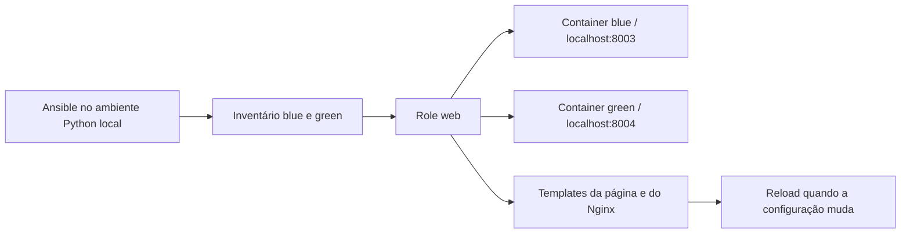

# Como o laboratório funciona

[English](guide.en.md) · [Voltar ao projeto](../README.md)

Execute os comandos na raiz do repositório.

## O que cada parte faz



Compose cria alvos que têm Python e ficam esperando tarefas. O role instala e configura Nginx dentro deles. O daemon Docker é acessado pelo plugin `community.docker.docker`, que executa os módulos nos containers via Docker CLI. O socket não é montado nos alvos.

O acesso ao daemon tem autoridade ampla; use o projeto apenas em um Docker sob seu controle. Não é necessário expor portas de SSH ou usar senhas/chaves neste exercício.

## Inventário, variáveis e role

- `inventory/hosts.yml`: grupo `web`, nome de cada container, conexão e Python remoto.
- `inventory/group_vars/web.yml`: título e ambiente comuns ao grupo.
- `roles/web/defaults/main.yml`: valores padrão, que o inventário pode sobrescrever.
- `roles/web/tasks/main.yml`: valida entradas, instala o pacote, cria a pasta, renderiza templates e inicia Nginx.
- `roles/web/handlers/main.yml`: recarrega Nginx após mudança na configuração.
- `playbooks/site.yml`: aplica o role ao grupo `web`.

Ambientes permitidos: `learning` e `staging`; cores: `blue` e `green`. Asserts rejeitam outros valores antes das tarefas de configuração. O caminho da página é limitado a `/srv/ansible-lab`.

```bash
bash scripts/ansible.sh inventory --graph
bash scripts/ansible.sh web -m ansible.builtin.ping
bash scripts/ansible.sh playbook playbooks/site.yml --syntax-check
```

O wrapper define `ANSIBLE_CONFIG` explicitamente, algo necessário em pastas WSL/Windows que aparecem como graváveis por todos. As dependências e caches ficam em `.local/`, sem instalar Ansible globalmente. O preparo usa `requirements.lock` quando presente e instala `community.docker` 5.4.0 sem dependências extras: o plugin de conexão usado aqui não requer os plugins de inventário adicionais.

## Templates e handler

A página identifica o host e o ambiente. A configuração adiciona os headers `X-Lab-Host` e `X-Lab-Environment`. Antes de substituir `nginx.conf`, o módulo template executa `nginx -t -c` no arquivo temporário; uma configuração inválida não deve substituir o arquivo em uso.

Só a configuração do Nginx notifica o handler. Alterar apenas HTML não precisa de reload. Várias notificações do mesmo handler são agrupadas na execução. Os testes observam a mudança de header após o reload.

Os containers não executam systemd. O pacote Debian fornece um script SysV em `/etc/init.d/nginx`, e o módulo `service` usa explicitamente esse mecanismo para iniciar e recarregar Nginx. Assim ele confere o estado do serviço, em vez de depender apenas da existência de um PID file. Em uma VM com systemd, adapte o backend de serviço ao ambiente.

O role também verifica se existem listas de pacotes antes de confiar na idade do cache apt. Uma imagem recém-criada pode ter removido essas listas mesmo que a pasta ainda tenha uma data recente.

## Check, diff e idempotência

```bash
bash scripts/ansible.sh playbook playbooks/site.yml --check --diff
bash scripts/ansible.sh playbook playbooks/site.yml --limit blue -e lab_environment=staging
bash scripts/ansible.sh playbook playbooks/site.yml
```

Check mode prevê mudanças dos módulos que o suportam; não é um ensaio perfeito de todas as operações. Use-o depois da primeira configuração neste projeto: alvos vazios ainda não têm pacotes/pastas necessários para validar os templates. Diff mostra o conteúdo alterado; não o use indiscriminadamente em arquivos com segredos.

Uma segunda execução logo após a primeira deve mostrar `changed=0`. O cache apt vale por 3600 segundos; após esse prazo uma atualização de metadados pode ser registrada como mudança mesmo sem alterar templates. Pacotes Debian não estão fixados a um snapshot, então downloads e versões podem mudar. A imagem base, o Ansible e a coleção estão fixados; isso não torna a instalação apt uma reprodução bit a bit.

## Testes e relatórios

`python3 tests/verify.py` exige que nenhum dos dois containers já exista. O teste sobe alvos novos, configura, verifica HTTP, repete o playbook, muda só blue, restaura os padrões, introduz drift, compara check mode com apply e rejeita uma variável inválida. Os targets ficam ligados no final; uma falha pode deixá-los parcialmente configurados. Inspecione logs antes de remover ou repetir o teste.

Um callback pequeno salva recaps e nomes dos handlers quando `LAB_RUN_REPORT` é definido. Ele não coleta conteúdo de módulos, senhas ou facts completos. Os testes combinam esse recap com respostas HTTP; não dependem apenas da aparência do log. Logs e relatórios completos ficam em `.local/` para revisão antes de compartilhar.

No CI, os mesmos testes rodam em runner Ubuntu com Python 3.13. Ao final, o runner remove os alvos do próprio laboratório. Artefatos selecionados ficam disponíveis por 14 dias. O token tem apenas `contents: read`, e as Actions são fixadas por SHA.

## Problemas comuns

- Docker permission denied: confira acesso ao daemon e integração WSL. Neste ambiente gerenciado, o uso do Docker exigiu execução autorizada fora do sandbox. Não torne o socket público.
- Python venv indisponível: instale o suporte a `venv` do seu Linux antes do preparo. No Windows, execute pelo WSL.
- Alvo não encontrado: rode `compose up -d --build` e confira os nomes do inventário.
- Página indisponível antes do playbook: é esperado; os containers começam sem Nginx configurado.
- Erro de pacote: confira rede e disponibilidade dos repositórios Debian.
- Porta ocupada: ajuste a porta do host no Compose e as URLs nos testes.

## Encerrar

```bash
bash scripts/compose.sh down
```

Remove somente os alvos/rede deste projeto. Não usa volumes persistentes. As portas 8003/8004 foram escolhidas para não ocupar as dos laboratórios anteriores.

## Leituras úteis

- [Conexão Docker do Ansible](https://docs.ansible.com/projects/ansible/latest/collections/community/docker/docker_connection.html)
- [Templates](https://docs.ansible.com/projects/ansible/latest/collections/ansible/builtin/template_module.html)
- [Handlers](https://docs.ansible.com/projects/ansible/latest/playbook_guide/playbooks_handlers.html)
- [Check e diff](https://docs.ansible.com/projects/ansible/latest/playbook_guide/playbooks_checkmode.html)
